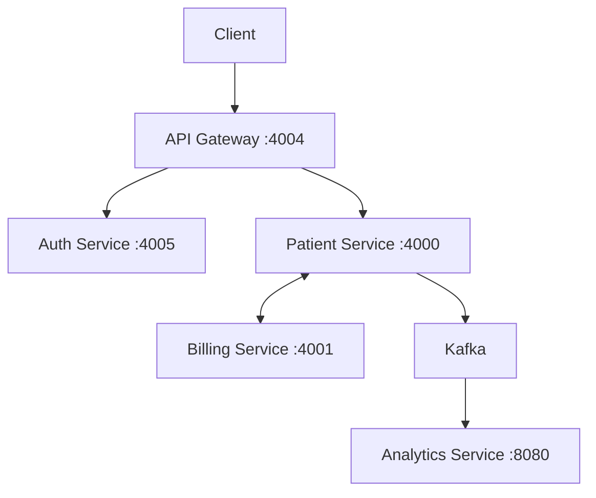


# Patient Management Microservices

**Developed & Maintained by Arshad Ghodake**

A Java Spring Boot-based microservices application demonstrating distributed service architecture with REST APIs, JWT authentication, gRPC communication, and Apache Kafka.

## Developer

**Arshad Ghodake**

- GitHub: https://github.com/ArshadGhodake
- Project: https://github.com/ArshadGhodake/patient-management-microservices

## Tech Stack

- Java 21
- Spring Boot
- Spring Cloud Gateway
- Spring Security & JWT
- Spring Data JPA
- H2 Database
- Apache Kafka
- gRPC & Protocol Buffers
- Maven
- Docker & Docker Compose
- Swagger / OpenAPI

## Architecture



## Microservices

| Service | HTTP Port | gRPC Port | Responsibility |
|---|---:|---:|---|
| API Gateway | 4004 | — | Routing and JWT validation |
| Patient Service | 4000 | 9090 | Patient management |
| Auth Service | 4005 | — | Authentication and JWT |
| Billing Service | 4001 | 9001 | Billing and gRPC |
| Analytics Service | 8080 | — | Kafka event consumption |

## Prerequisites

- Java 21
- Maven (Maven Wrapper included in service directories)
- Docker Desktop
- Git

## Getting Started

### 1. Clone the repository

```bash
git clone https://github.com/ArshadGhodake/patient-management-microservices.git
cd patient-management-microservices
```

### 2. Start Kafka

```bash
docker compose up -d
```

Check running containers:

```bash
docker compose ps
```

### 3. Configure JWT Secret

Set a secure Base64-encoded JWT secret of at least 32 bytes using the `JWT_SECRET` environment variable before starting Auth Service.

Never commit production secrets to GitHub.

### 4. Build the services

Each microservice is a separate Maven project.

Open the respective service directory and execute:

```powershell
.\mvnw.cmd clean package -DskipTests
```

Repeat for each service that needs to be built.

### 5. Run the microservices

Open each service directory in a separate terminal and run:

```powershell
.\mvnw.cmd spring-boot:run
```

Start Billing Service before Patient Service because Patient Service uses its gRPC server.

## API Documentation

Once services are running:

| Service | Swagger URL |
|---|---|
| Patient Service | http://localhost:4000/swagger-ui/index.html |
| Auth Service | http://localhost:4005/swagger-ui/index.html |

Gateway API documentation:

http://localhost:4004/api-docs/patients

## Features

- Microservices-based architecture
- Patient REST API and CRUD operations
- JWT-based authentication and authorization
- API Gateway routing and token validation
- Inter-service gRPC communication
- Kafka-based event consumption
- API documentation using Swagger / OpenAPI
- Docker-based Kafka setup

## Credits

This project was developed and extended by Arshad Ghodake as an independent learning and implementation project.

The implementation was inspired by concepts and learning material from the Java Spring Microservices course by Chris Blakely.

## License

This repository may contain code or concepts derived from third-party learning material. Refer to the original repository and applicable third-party component licenses before redistribution.
