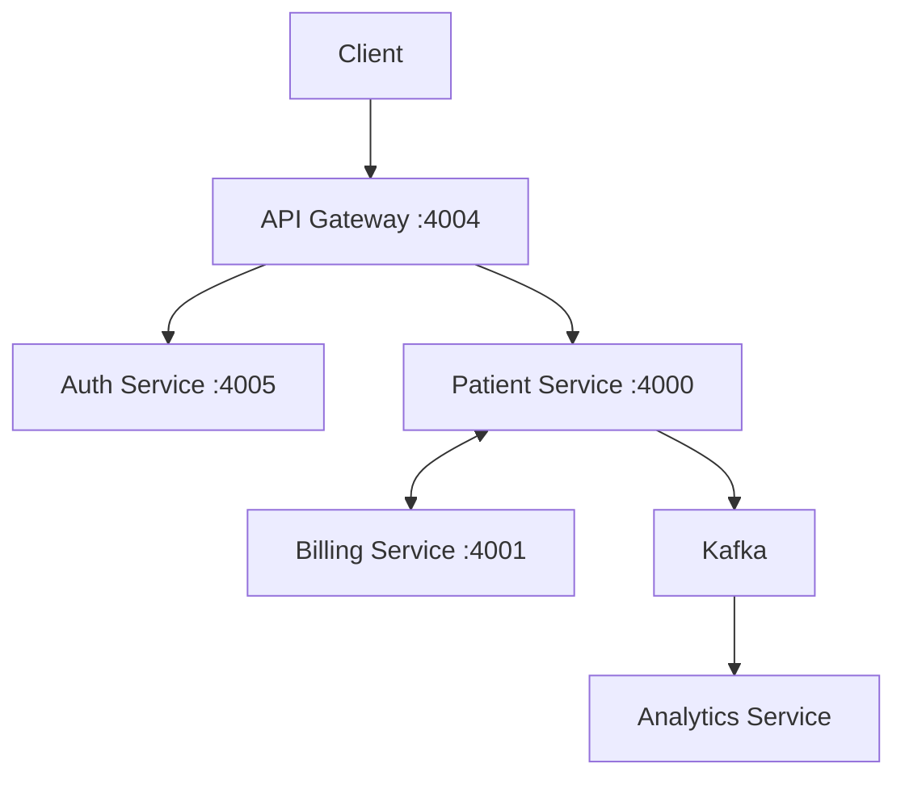


# Patient Management Microservices

**Developed & Maintained by Arshad Ghodake**

A Java Spring Boot based microservices application demonstrating distributed service architecture with REST APIs, authentication, gRPC communication and Apache Kafka.

## Developer

**Arshad Ghodake**

- GitHub: https://github.com/ArshadGhodake
- Project: https://github.com/ArshadGhodake/patient-management-microservices

## Tech Stack

- Java 21
- Spring Boot
- Spring Cloud Gateway
- Spring Security & JWT
- Spring Data JPA
- H2 Database
- Apache Kafka
- gRPC & Protocol Buffers
- Maven
- Docker & Docker Compose
- Swagger / OpenAPI

## Architecture



## Microservices

| Service | Port | Responsibility |
|---|---:|---|
| API Gateway | 4004 | Routing and JWT validation |
| Patient Service | 4000 | Patient management |
| Auth Service | 4005 | Authentication and JWT |
| Billing Service | 4001 | Billing and gRPC |
| Analytics Service | Check configuration | Kafka event consumption |

## Prerequisites

- Java 21
- Maven 3.10+
- Docker Desktop
- Git

## Getting Started

### 1. Clone the repository

```bash
git clone https://github.com/ArshadGhodake/patient-management-microservices.git
cd patient-management-microservices
```

### 2. Start Kafka

```bash
docker compose up -d
```

Check container:

```bash
docker compose ps
```

### 3. Configure JWT Secret

Set a secure Base64-encoded JWT secret of at least 32 bytes using the `JWT_SECRET` environment variable before starting Auth Service.

### 4. Build the project

```bash
mvn clean install -DskipTests
```

### 5. Run the microservices

Run each Spring Boot service from its respective module using Maven:

```bash
mvn spring-boot:run
```

Start Billing Service before Patient Service because Patient Service uses its gRPC server.

## API Documentation

Once services are running:

| Service | Swagger URL |
|---|---|
| Patient Service | http://localhost:4000/swagger-ui/index.html |
| Auth Service | http://localhost:4005/swagger-ui/index.html |

Gateway API documentation:

http://localhost:4004/api-docs/patients

## Features

- Microservices-based architecture
- Patient REST API
- JWT-based authentication
- API Gateway routing
- Inter-service gRPC communication
- Kafka-based event consumption
- API documentation using Swagger
- Docker-based Kafka setup

## Credits

This project was developed as an independent learning and implementation project, inspired by the Java Spring Microservices course by Chris Blakely.

## License

Refer to the original repository and applicable third-party component licenses before redistribution.
